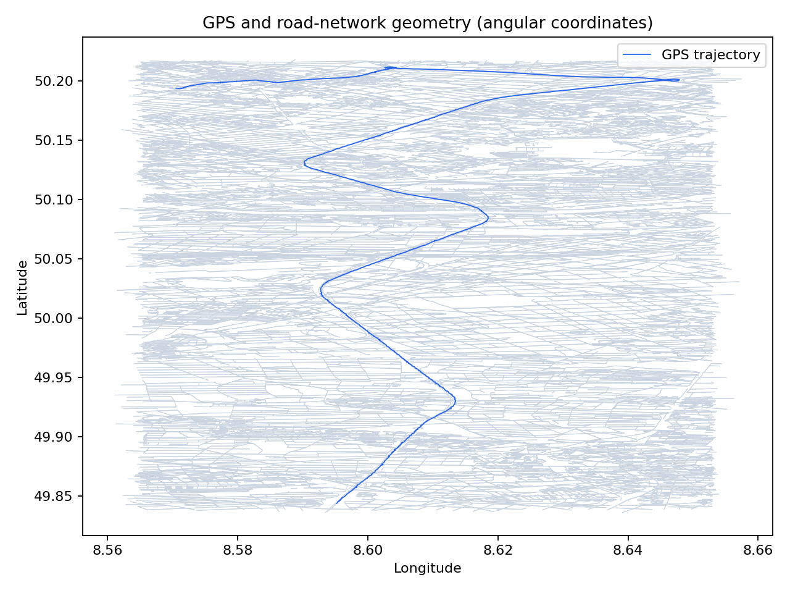
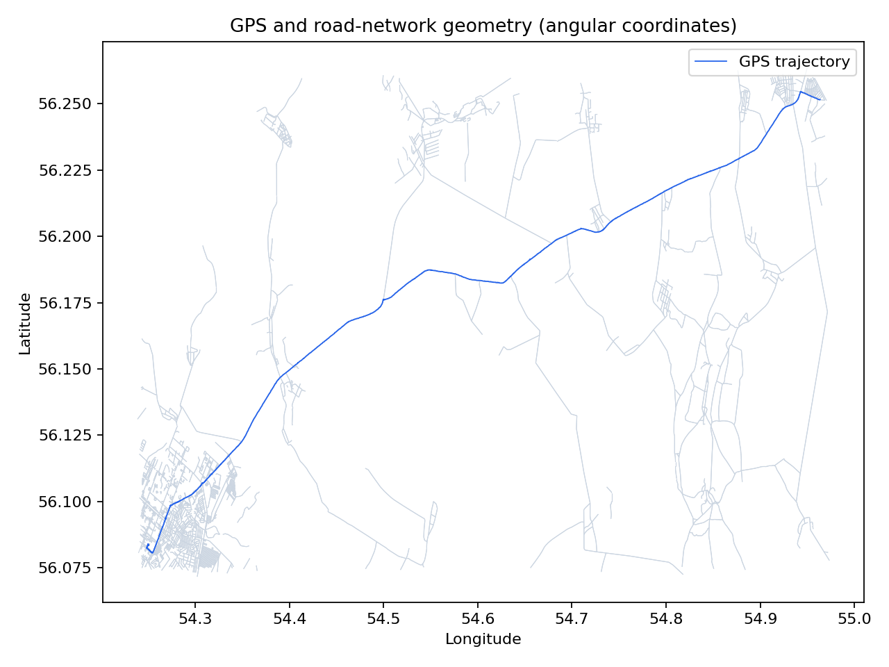
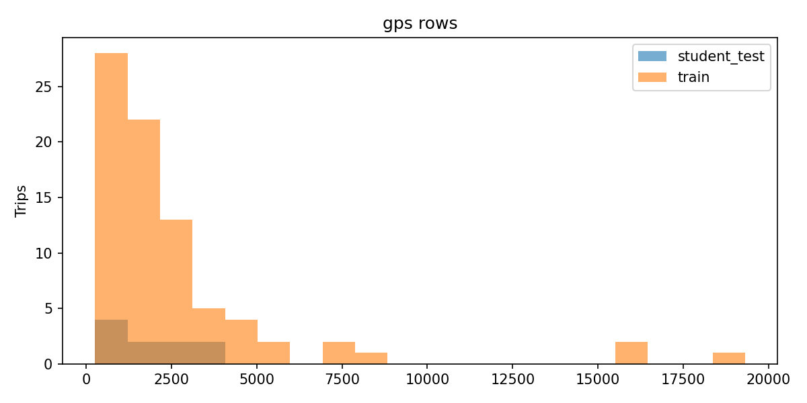
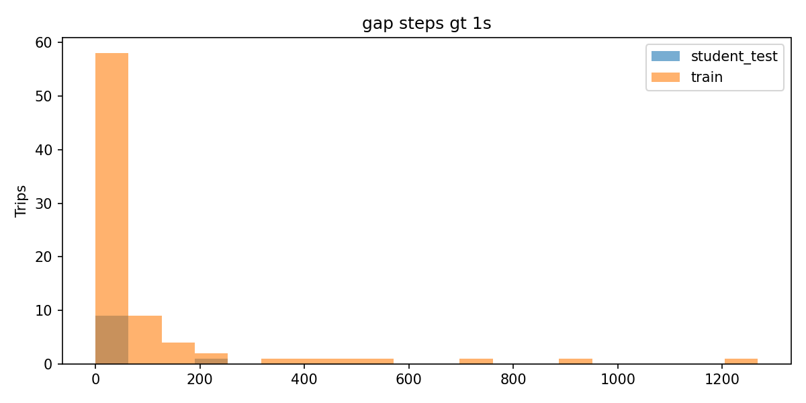
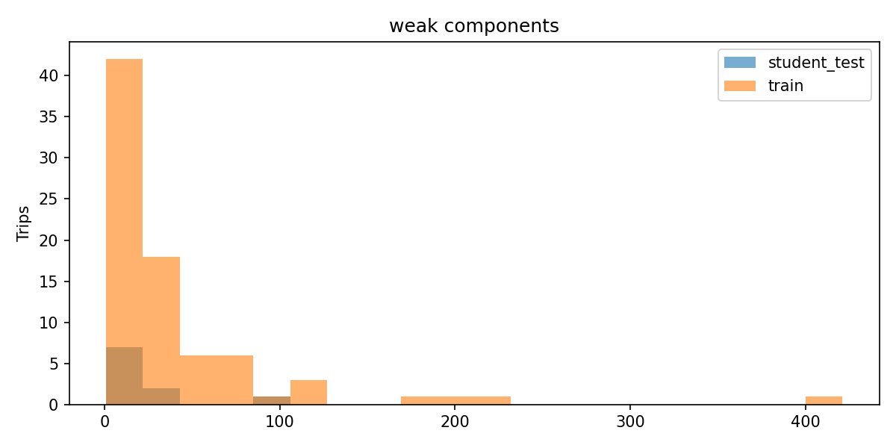
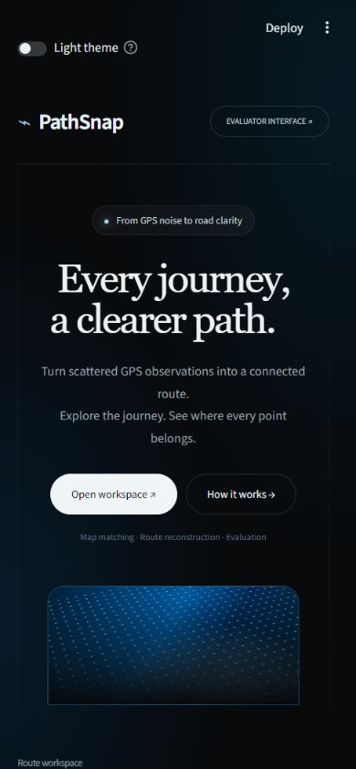
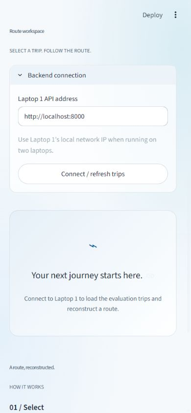

# PATHSNAP: completed EDA and UI report sections

This document records completed work. It is not the final consolidated technical
report: real model experiments, HMM results and two-laptop evidence are pending.
Figures and statistics below come from the team's actual raw-data exploration.
No synthetic model-check scores are included.

## Dataset understanding and processing

We inspected all 80 training and 10 student-test trips. Each trip contains its
matching .track, .nodes, .arcs and .route files. No evaluator partition was used.
The partitions have disjoint raw trip IDs. File row indices are preserved as
node and arc IDs; route entries are traversed arc IDs, not GPS observation labels.

Exploration does not rewrite the raw files. Numeric parsing counts malformed
rows and missing values; checks cover longitude/latitude ranges, finite values,
timestamp order, time gaps, integer arc endpoints and route-ID bounds. Distances
use haversine calculations in metres, with mean Earth radius 6,371,008.8 m.
Apparent speeds and distances use only adjacent valid observations with positive
time differences. Connectivity is measured on the full directed road graph.
Weak connectivity ignores direction; strong connectivity respects direction.

## Measured results

| Measure | Training | Student test |
| --- | --- | --- |
| Trips | 80 | 10 |
| GPS observations | 208,417 | 19,160 |
| Observations per trip (min / median / max) | 361 / 1,529 / 19,313 | 262 / 1,420 / 3,958 |
| Invalid GPS rows | 0 | 0 |
| Trips with non-increasing timestamps | 0 | 0 |
| Trips with gaps > 1 second | 60 | 6 |
| Largest time gap (seconds) | 153,064 | 210 |
| Nodes per trip (min / max) | 299 / 155,003 | 1,770 / 26,635 |
| Arcs per trip (min / max) | 649 / 307,392 | 3,577 / 56,027 |
| Weak components per trip (min / max) | 1 / 421 | 5 / 100 |
| Isolated nodes | 0 | 0 |
| Invalid node / arc / reference IDs | 0 / 0 / 0 | 0 / 0 / 0 |

Exactly one-second intervals account for **96.50%** of finite training
steps and **98.62%** of finite student-test steps. Counts refer to time
intervals, not percentages of GPS observations. All four file types are present
for every trip. Zero invalid GPS rows does not establish that GPS is noise-free.
Similarly, valid reference IDs do not establish error-free ground truth.

### Largest observed gaps

| Partition | Trip | Largest gap (seconds) |
| --- | --- | --- |
| train | 00000090 | 153,064 |
| train | 00000078 | 52,810 |
| train | 00000069 | 2,658 |
| train | 00000021 | 2,161 |
| train | 00000011 | 909 |

The largest gap is over 42 hours. A decoder should handle gaps explicitly rather
than assuming continuous one-second movement. Network graphs may contain many
disconnected components even without isolated nodes; transitions between arbitrary
candidate segments cannot be assumed valid.

GPS latitude spans both hemispheres and longitude varies widely across trips.
A single projection chosen for one city would be unsuitable across the whole
dataset. Haversine distances avoid that assumption during EDA; feature engineering
must choose per-trip projections or appropriate geodesic calculations.

## Geographical evidence

Training example 00000001: blue GPS trajectory and grey roads. Degree axes are
for display, not physical-distance calculations.

Student-test example 00000000, shown separately from training evidence.

Interactive Folium maps include GPS observations (blue), reference-route arcs
(green), and switchable road geometry (grey):

- [Training development map](../results/eda/maps/train_00000001.html)
- [Student-test development map](../results/eda/maps/student_test_00000000.html)

These are development visualisations. They show no model prediction and are
not exposed as evaluator ground truth. Displayed roads are clipped to each
trip bounding box with a 0.005-degree margin; graph counts remain unfiltered.

The overlays use the same bins for both partitions so distributions can be
compared on a common scale. Unequal partition sizes affect histogram heights.

## Implications and feature plan

GPS-to-road distance and heading difference are plausible candidate features;
speed and elapsed time can describe movement between observations. They are
proposals until Laptop 1 supplies the generated table and alignment policy.
Reference-derived quantities must not become inference predictors. We have not
measured feature importance, candidate-class imbalance or candidate miss rate
from the raw files; those require generated candidates and aligned labels.

## Model experiment plan

Compare Logistic Regression, distance-weighted kNN, Random Forest,
HistGradientBoosting and a shallow MLP across five algorithm families. Use the
same trip-grouped CV splits, fit preprocessing within each fold and choose by
mean observation-level Top-1 accuracy. Also record required candidate Macro F1,
precision/recall, binary Log Loss, candidate misses and inference time. Optional
sigmoid calibration uses an inner trip-grouped split. Bayesian search also uses
the training folds, never evaluator data. No winner or performance improvement
is claimed before real experiments.

## Evaluator interface implementation

The Streamlit UI provides dark/light modes, backend address entry, catalogue
loading, trip selection, reconstruction requests, returned metrics, a Folium
route map and HTML/JSON downloads. It sends only the selected trip ID to
POST /predict and obtains the catalogue from GET /trips. Unknown or missing
metrics are not replaced by fabricated scores. Failed requests and changes to
trip/server clear outdated results. Theme changes retain the current result.

The evaluator map displays GPS, predicted geometry and optional roads. Reference
labels and reference geometry must remain on Laptop 1. Downloads allowlist
documented public fields and aggregate metrics. The hero's blue point artwork
is decorative, not a dataset visualisation. Folium assets/tiles need internet.

### Actual interface screenshots

These are genuine browser captures before backend integration. The mobile
check used a 390 x 844 viewport in both themes and found no page-level horizontal
overflow. An unreadable light-theme connection header was corrected and verified.
No screenshot is evidence of real model performance.

The UI runs on Laptop 2; model inference and server-side reference scoring run
on Laptop 1. Real endpoint integration and all ten evaluation-trip runs are
pending. UI checks with simulated responses are software checks, not evaluation
evidence. Screenshots of real API calls will be added after integration.

## Reproduction and provenance

Run scripts/explore_dataset.py, then scripts/write_eda_report.py. Inventory and
methodology are in results/eda; full commands and metric definitions are in
docs/laptop2_runbook.md. A source-file SHA-256 manifest accompanies this report
as reports/eda_source_manifest.json. Sums of nodes/arcs across trips would count
repeated network geometry, so the table reports per-trip ranges instead.

The final PDF must add actual model-by-model analysis, tuning results, decoder
comparisons, UI/API evidence and the team's conclusions. Team members should
review this draft against their own understanding and disclose assistance
according to the event's policy.
